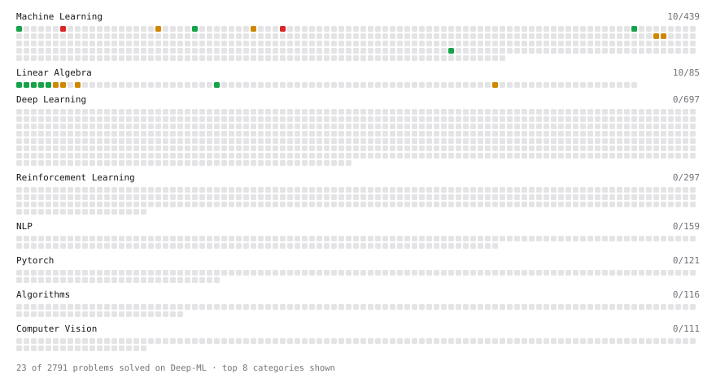

# Deep-ML

My machine learning practice from [Deep-ML](https://www.deep-ml.com). Every solution here was written by hand.

**29** solved · 20 problems · 0 labs · 9 math

[**Browse the interactive portfolio**](https://EvilX11.github.io/deep-ml/) to replay this filling in over time.

## Problems

| | Difficulty | Solved | |
| --- | --- | --- | --- |
| [Calculate Mean by Row or Column](https://www.deep-ml.com/problems/4) | easy | 2026-11-03 | [solution](problems/0004-calculate-mean-by-row-or-column) |
| [Derivative of a Polynomial](https://www.deep-ml.com/problems/116) | easy | 2026-11-19 | [solution](problems/0116-derivative-of-a-polynomial) |
| [Dot Product Calculator](https://www.deep-ml.com/problems/83) | easy | 2026-11-11 | [solution](problems/0083-dot-product-calculator) |
| [Gradient Direction and Magnitude](https://www.deep-ml.com/problems/308) | easy | 2026-11-19 | [solution](problems/0308-gradient-direction-and-magnitude) |
| [Linear Regression Using Normal Equation](https://www.deep-ml.com/problems/14) | easy | 2026-11-03 | [solution](problems/0014-linear-regression-using-normal-equation) |
| [Matrix-Vector Dot Product](https://www.deep-ml.com/problems/1) | easy | 2026-11-10 | [solution](problems/0001-matrix-vector-dot-product) |
| [Recursive Least Squares for Simple Linear Regression](https://www.deep-ml.com/problems/1820) | easy | 2026-11-12 | [solution](problems/1820-recursive-least-squares-for-simple-linear-regression) |
| [Reshape Matrix](https://www.deep-ml.com/problems/3) | easy | 2026-11-03 | [solution](problems/0003-reshape-matrix) |
| [Scalar Multiplication of a Matrix](https://www.deep-ml.com/problems/5) | easy | 2026-11-03 | [solution](problems/0005-scalar-multiplication-of-a-matrix) |
| [Transpose of a Matrix](https://www.deep-ml.com/problems/2) | easy | 2026-11-02 | [solution](problems/0002-transpose-of-a-matrix) |
| [Calculate Eigenvalues of a Matrix](https://www.deep-ml.com/problems/6) | medium | 2026-11-03 | [solution](problems/0006-calculate-eigenvalues-of-a-matrix) |
| [Chain Rule for Composite Functions](https://www.deep-ml.com/problems/214) | medium | 2026-11-19 | [solution](problems/0214-chain-rule-for-composite-functions) |
| [Implement Gradient Descent Variants with MSE Loss](https://www.deep-ml.com/problems/47) | medium | 2026-11-04 | [solution](problems/0047-implement-gradient-descent-variants-with-mse-loss) |
| [Linear Regression - Power Grid Optimization](https://www.deep-ml.com/problems/92) | medium | 2026-11-12 | [solution](problems/0092-linear-regression-power-grid-optimization) |
| [Matrix times Matrix ](https://www.deep-ml.com/problems/9) | medium | 2026-11-10 | [solution](problems/0009-matrix-times-matrix) |
| [Matrix Transformation ](https://www.deep-ml.com/problems/7) | medium | 2026-11-03 | [solution](problems/0007-matrix-transformation) |
| [Partial Derivatives of Multivariable Functions](https://www.deep-ml.com/problems/215) | medium | 2026-11-19 | [solution](problems/0215-partial-derivatives-of-multivariable-functions) |
| [Stochastic Gradient Descent Step for Linear Regression](https://www.deep-ml.com/problems/802) | medium | 2026-11-17 | [solution](problems/0802-stochastic-gradient-descent-step-for-linear-regression) |
| [Decision Tree Learning](https://www.deep-ml.com/problems/20) | hard | 2026-11-09 | [solution](problems/0020-decision-tree-learning) |
| [Train Logistic Regression with Gradient Descent](https://www.deep-ml.com/problems/106) | hard | 2026-11-04 | [solution](problems/0106-train-logistic-regression-with-gradient-descent) |

## Math

| | Difficulty | Solved | |
| --- | --- | --- | --- |
| [Derivatives and Gradients](https://www.deep-ml.com/math-problems/1) | easy | 2026-11-18 | [solution](math/0001-derivatives-and-gradients) |
| [Gradient Descent Updates](https://www.deep-ml.com/math-problems/5) | easy | 2026-11-20 | [solution](math/0005-gradient-descent-updates) |
| [Matrix Basics](https://www.deep-ml.com/math-problems/9) | easy | 2026-11-11 | [solution](math/0009-matrix-basics) |
| [Vector Operations](https://www.deep-ml.com/math-problems/7) | easy | 2026-11-11 | [solution](math/0007-vector-operations) |
| [Why Minibatches: Gradient Variance vs Batch Size](https://www.deep-ml.com/math-problems/130) | easy | 2026-11-20 | [solution](math/0130-why-minibatches-gradient-variance-vs-batch-size) |
| [Inverse and Rank](https://www.deep-ml.com/math-problems/12) | medium | 2026-11-11 | [solution](math/0012-inverse-and-rank) |
| [Matrix Multiplication](https://www.deep-ml.com/math-problems/10) | medium | 2026-11-10 | [solution](math/0010-matrix-multiplication) |
| [Multivariate Calculus](https://www.deep-ml.com/math-problems/2) | medium | 2026-11-19 | [solution](math/0002-multivariate-calculus) |
| [Orthogonality and Projections](https://www.deep-ml.com/math-problems/14) | medium | 2026-11-11 | [solution](math/0014-orthogonality-and-projections) |

---

_This file is regenerated by Deep-ML on every push._
